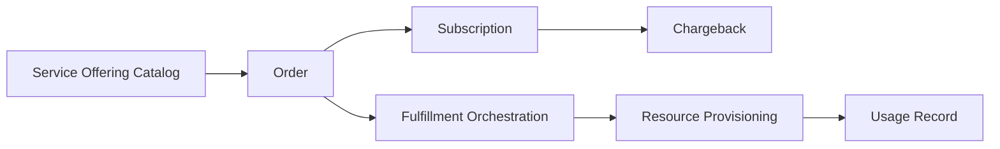

docType: ITCF

# IT4IT Consume & Fulfil Template

> The IT4IT Consume & Fulfil functions (S261, Ch. 8): the Consume function
> (consumption experience, identity, offering, order, chargeback) and the
> Fulfill function (change, resource provisioning, fulfillment orchestration,
> usage).

## Intake Interview Questions

The template-driven intake interview asks the questions below before rendering this
artefact. Every question below is always put to the user for their input, one
question at a time, and is prefilled where answerable from existing artefacts,
saved intake, onboarding data, or organisation config so the user can confirm or
override it. Each question is **optional**: a skipped question renders as a
`TBD` marker in the artefact. Source: The Open Group IT4IT Standard, Version 3.1
(Snapshot), S261 (reference only — not a conformance claim).

### Intake questions (IT4IT consume & fulfil)

- **Service catalog:** What service offerings are in the catalog, and how are they defined/published?
- **Consumer lifecycle:** How do consumers select, agree, subscribe, and receive support/status?
- **Chargeback:** What is the chargeback contract and record model?
- **Fulfillment:** How are changes managed, resources provisioned, and usage tracked?

| Field | Value |
|---|---|
| **Issue** | `${user_config.project_issue_prefix}-000` — IT4IT Consume & Fulfil |
| **Parent** | `${user_config.references_dir}` — parent engagement reference, if any |
| **Organisation** | `${user_config.organisation_name}` |
| **Date** | 2026-11-06 |
| **Status** | Draft |
| **Author** | Enterprise Architecture Lead |
| **Owner** | Catalog Manager / Service Delivery Lead |
| **Replaces** | — |

### IT4IT Standard (S261) interview questions

Grounded in the IT4IT v3.1 Request to Fulfill functions (S261 Ch. 8); each
answer feeds the function definitions below.

- **Consume components (S261 Ch. 8):** Which consume components are in scope — consumption experience, identity, offering, order, chargeback?
- **Fulfill components (S261 Ch. 8):** Which fulfill components are in scope — change, fulfillment orchestration, resource, fulfillment, usage?
- **Service Offering backbone (S261 Ch. 11):** How are the Service Offering, Order, and Subscription KDOs structured, and what is their system of record?
- **Service Contract (S261 Ch. 8):** How is the Service Contract (Digital Product Contract) created, updated, and enforced?

## Consume Function

| Component | Data Objects | Notes |
|---|---|---|
| **Consumption Experience** | Interaction | |
| **Identity** | Identity, Entitlement | |
| **Offering** | Service Offering Catalog, Service Offering | |
| **Order** | Order, Subscription | |
| **Chargeback** | Chargeback Contract, Chargeback Record | |

### Consumer Lifecycle

Select an Offering → Agree to Service Offering → Subscribe → Provide Service Support → Publish Service Status

## Fulfill Function

| Component | Data Objects | Notes |
|---|---|---|
| **Change** | Change | |
| **Resource** | Desired Product Instance, Resource, Capacity Plan | |
| **Fulfillment Orchestration** | Fulfillment Book | |
| **Usage** | Usage Record | |

## Service Contract

| Field | Value |
|---|---|
| **Creation owner** | Consume function |
| **Update trigger** | |
| **Enforcement** | |

## Cardinalities and Systems of Record

| KDO | Cardinality | System of Record |
|---|---|---|
| Service Offering ↔ Product Release | n:m | |
| Order → Subscription | 1:m | |
| Order ↔ Service Offering | n:m | |
| Chargeback Contract ↔ Order | 1:n | |
| Change ↔ Desired Product Instance | n:m | |
| Fulfillment Book ↔ Usage Record | 1:m | |

## Conformance Notes

This artefact **references** the IT4IT Standard v3.1 (S261, snapshot) as a
reference architecture. S261 is a snapshot, not an approved standard; no
conformance claim is made. Vendor tooling choices (catalog, billing systems)
are non-normative extensions.

## Mermaid

