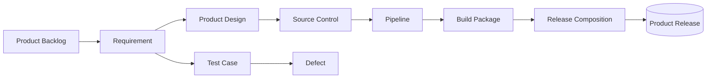

# IT4IT Develop & Test Template

> The IT4IT Develop & Test functions (S261, Ch. 7): the Develop function
> (product backlog, requirement, design, source, pipeline, build package,
> release composition) and the Test function (test case, test plan, defect).

## Intake Interview Questions

The template-driven intake interview asks the questions below before rendering this
artefact. Every question below is always put to the user for their input, one
question at a time, and is prefilled where answerable from existing artefacts,
saved intake, onboarding data, or organisation config so the user can confirm or
override it. Each question is **optional**: a skipped question renders as a
`TBD` marker in the artefact. Source: The Open Group IT4IT Standard, Version 3.1
(Snapshot), S261 (reference only — not a conformance claim).

### Intake questions (IT4IT develop & test)

- **Product backlog:** What is the product backlog structure, and how are items prioritised?
- **Pipeline shape:** What are the CI/CD pipeline stages, and what guardrails apply at each?
- **Build packages:** What are the build package rules, and how do build packages compose into a Product Release?
- **Testing model:** How are test cases and test plans traced to requirements, and what is the defect lifecycle?

| Field | Value |
|---|---|
| **Issue** | `${user_config.project_issue_prefix}-000` — IT4IT Develop & Test |
| **Parent** | `${user_config.references_dir}` — parent engagement reference, if any |
| **Organisation** | `${user_config.organisation_name}` |
| **Date** | 2026-11-06 |
| **Status** | Draft |
| **Author** | Enterprise Architecture Lead |
| **Owner** | Product Manager / Delivery Lead |
| **Replaces** | — |

### IT4IT Standard (S261) interview questions

Grounded in the IT4IT v3.1 Requirement to Deploy functions (S261 Ch. 7); each
answer feeds the function definitions below.

- **Develop components (S261 Ch. 7):** Which develop components are in scope — product backlog, requirement, product design, source control, pipeline, build package, release composition?
- **Test components (S261 Ch. 7):** How are test cases, test plans, and defects structured, and how do they trace to requirements?
- **Integrate stream mapping (S261 Ch. 5):** How do the Integrate stages — Plan Product Release → Design & Develop → Build, Integrate, & Test → Accept & Publish Release — map onto the functional components?
- **Quality gates (S261 Ch. 7):** What are the quality gates at each Integrate stage, and what are the exit criteria?

## Develop Function

| Component | Data Objects | Notes |
|---|---|---|
| **Product Backlog** | Product Backlog Item, Requirement | |
| **Product Design** | Product Design, Capacity Model | |
| **Source Control** | Source | |
| **Pipeline** | Pipeline | CI/CD guardrails |
| **Build Package** | Build Package | Deployable unit |
| **Release Composition** | Product Release, Product Release Blueprint | How build packages combine |

## Pipeline

| Stage | Guardrails | Exit Criteria |
|---|---|---|
| | | |

## Test Function

| Component | Data Objects | Notes |
|---|---|---|
| **Test** | Test Case, Test Plan | Traced to requirements |
| **Defect** | Defect | Lifecycle: open → assigned → resolved → verified → closed |

## Quality Gates

| Gate (Integrate stage) | Entry Criteria | Exit Criteria |
|---|---|---|
| | | |

## Cardinalities and Systems of Record

| KDO | Cardinality | System of Record |
|---|---|---|
| Product Backlog Item → Requirement | 1:m | |
| Requirement → Product Design | n:m | |
| Pipeline → Build Package | 1:m | |
| Build Package → Product Release | n:m | |
| Test Case → Requirement | n:m | |
| Defect → Requirement | n:m | |

## Conformance Notes

This artefact **references** the IT4IT Standard v3.1 (S261, snapshot) as a
reference architecture. S261 is a snapshot, not an approved standard; no
conformance claim is made. Vendor tooling choices (pipeline, build systems)
are non-normative extensions.

## Mermaid

