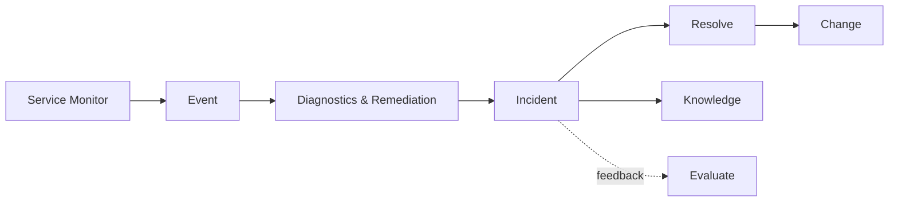

docType: ITOA

# IT4IT Operate & Assure Template

> The IT4IT Operate & Assure functions (S261, Ch. 9) plus Supporting
> Functions cross-reference (S261 Ch. 10): the Support function (service
> level, incident, problem, knowledge) and the Assure function
> (configuration, monitoring, event, diagnostics & remediation).

## Intake Interview Questions

The template-driven intake interview asks the questions below before rendering this
artefact. Every question below is always put to the user for their input, one
question at a time, and is prefilled where answerable from existing artefacts,
saved intake, onboarding data, or organisation config so the user can confirm or
override it. Each question is **optional**: a skipped question renders as a
`TBD` marker in the artefact. Source: The Open Group IT4IT Standard, Version 3.1
(Snapshot), S261 (reference only — not a conformance claim).

### Intake questions (IT4IT operate & assure)

- **Service levels:** What KPIs/SLOs are measured against the Service Contract?
- **Incident & problem:** What is the incident/problem lifecycle and prioritisation model?
- **Monitoring & assurance:** What service monitors, logs, and events are in scope?
- **Remediation:** What runbooks exist, and what are the automated-remediation boundaries?
- **Supporting functions:** Which supporting functions (financial, GRC, workforce, sourcing, intelligence, collaboration) apply?

| Field | Value |
|---|---|
| **Issue** | `${user_config.project_issue_prefix}-000` — IT4IT Operate & Assure |
| **Parent** | `${user_config.references_dir}` — parent engagement reference, if any |
| **Organisation** | `${user_config.organisation_name}` |
| **Date** | 2026-11-06 |
| **Status** | Draft |
| **Author** | Enterprise Architecture Lead |
| **Owner** | Service Operations / Platform Ops Lead |
| **Replaces** | — |

### IT4IT Standard (S261) interview questions

Grounded in the IT4IT v3.1 Detect to Correct functions (S261 Ch. 9) and
Supporting Functions (S261 Ch. 10); each answer feeds the function definitions
below.

- **Support components (S261 Ch. 9):** Which support components are in scope — service level, incident, problem, knowledge?
- **Assure components (S261 Ch. 9):** Which assure components are in scope — configuration, monitoring, event, diagnostics & remediation?
- **Operate stream mapping (S261 Ch. 5):** How do the Operate stages — Detect Issue → Diagnose Issue → Resolve Issue — map onto the functional components?
- **Supporting functions (S261 Ch. 10):** Which supporting functions attach to this operating model, and how?

## Support Function

| Component | Data Objects | Notes |
|---|---|---|
| **Service Level** | Service Contract, KPI | Measured against contract |
| **Incident** | Incident | Lifecycle: detected → triaged → resolved → closed |
| **Problem** | Problem | Root-cause, feeds knowledge |
| **Knowledge** | Knowledge Item | Runbook linkage |

## Assure Function

| Component | Data Objects | Notes |
|---|---|---|
| **Configuration** | Actual Product Instance | Inventory |
| **Monitoring** | Service Monitor, Log, Event | |
| **Diagnostics & Remediation** | Runbook | Automated-remediation boundaries |

### Runbooks

| Runbook | Trigger | Remediation Boundary |
|---|---|---|
| | | |

## Supporting Functions Cross-Reference

| Supporting Function (S261 Ch. 10) | Applies? | How it attaches |
|---|---|---|
| Financial Management | | Cost Model, Budget Item |
| Governance, Risk, & Compliance | | GRC across value streams |
| Workforce Management | | Capacity planning for people |
| Sourcing & Vendor Management | | Vendor lifecycle, procurement |
| Intelligence & Reporting | | Analytics, dashboards, service reporting |
| Collaboration & Communication | | Stakeholder comms, service status |

## Cardinalities and Systems of Record

| KDO | Cardinality | System of Record |
|---|---|---|
| Service Contract → KPI | 1:m | |
| Incident ↔ Service Contract | n:m | |
| Problem → Knowledge Item | 1:m | |
| Service Monitor → Actual Product Instance | n:m | |
| Event → Runbook | n:m | |

## Conformance Notes

This artefact **references** the IT4IT Standard v3.1 (S261, snapshot) as a
reference architecture. S261 is a snapshot, not an approved standard; no
conformance claim is made. Vendor tooling choices (monitoring, incident
management systems) are non-normative extensions.

## Mermaid

