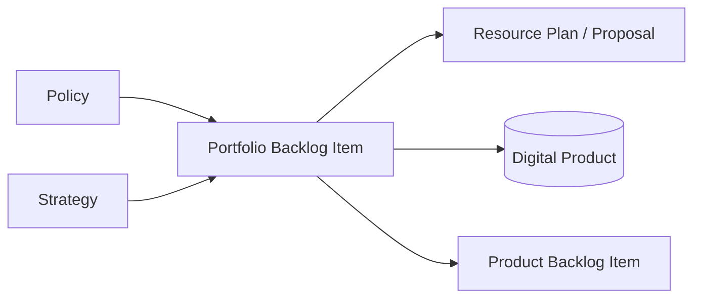

docType: ITSF

# IT4IT Strategy to Portfolio Template

> The IT4IT Strategy to Portfolio functions (S261, Ch. 6): policy, strategy,
> portfolio backlog, and proposal components with their key data objects and
> cardinalities. Product-based investment — Portfolio Backlog Items are the
> unit of funding, not projects.

## Intake Interview Questions

The template-driven intake interview asks the questions below before rendering this
artefact. Every question below is always put to the user for their input, one
question at a time, and is prefilled where answerable from existing artefacts,
saved intake, onboarding data, or organisation config so the user can confirm or
override it. Each question is **optional**: a skipped question renders as a
`TBD` marker in the artefact. Source: The Open Group IT4IT Standard, Version 3.1
(Snapshot), S261 (reference only — not a conformance claim).

### Intake questions (IT4IT strategy to portfolio)

- **Policy framework:** What is the policy review/approval/audit cadence, and applicable geography?
- **Strategy:** What strategic themes and strategic objectives govern this portfolio?
- **Portfolio backlog:** How are Portfolio Backlog Items prioritised, and what demand profile / cost estimation model is used?
- **Resource plans:** How are funding packages (resource plans) structured, and what is the proposal state machine?

| Field | Value |
|---|---|
| **Issue** | `${user_config.project_issue_prefix}-000` — IT4IT Strategy to Portfolio |
| **Parent** | `${user_config.references_dir}` — parent engagement reference, if any |
| **Organisation** | `${user_config.organisation_name}` |
| **Date** | 2026-11-06 |
| **Status** | Draft |
| **Author** | Enterprise Architecture Lead |
| **Owner** | Digital Product Portfolio Manager |
| **Replaces** | — |

### IT4IT Standard (S261) interview questions

Grounded in the IT4IT v3.1 Strategy to Portfolio chapter (S261 Ch. 6); each
answer feeds the function definitions below.

- **Policy component (S261 Ch. 6):** Which policies govern the digital products, and what is their lifecycle (create → review → approve → audit)?
- **Strategy component (S261 Ch. 6):** What are the strategic themes (direction + priorities) and the strategic objectives (actionable + measurable) they summarise?
- **Portfolio backlog component (S261 Ch. 6):** What is the PBI lifecycle, and how are PBIs related to Strategic Objectives, Architecture Roadmap Items, Policies, Resource Plans, and Digital Products?
- **Proposal component (S261 Ch. 6):** What are the states of a resource plan / proposal — proposed, approved, active, deferred, rejected — and what moves between them?

## Policy Framework

| Field | Value |
|---|---|
| **Policies in scope** | |
| **Lifecycle** | create → review → approve → audit |
| **Review cadence** | |
| **Applicable geography** | |

## Strategy

### Strategic Themes

- [ ] Theme 1: [statement of direction + priorities]

### Strategic Objectives

| Strategic Objective | Measures / Target | Stakeholder |
|---|---|---|
| | | |

> Every strategic objective must be actionable and measurable.

## Portfolio Backlog

| PBI | Prioritisation | Demand Profile | Cost Estimate | Related Products |
|---|---|---|---|---|
| | | | | |

### PBI Relationships

| PBI | Strategic Objective (n:m) | Architecture Roadmap Item (n:1) | Policy (n:m) | Resource Plan (1:1) | Digital Product (n:m) |
|---|---|---|---|---|---|
| | | | | | |

## Proposal and Resource Plans

| Resource Plan | PBI(s) | State | Funding Commitment |
|---|---|---|---|
| | | | |

### Proposal State Machine

`proposed → approved → active` (terminal: `deferred`, `rejected`)

## Cardinalities and Systems of Record

| KDO | Cardinality | System of Record |
|---|---|---|
| Portfolio Backlog Item ↔ Strategic Objective | n:m | |
| Portfolio Backlog Item ↔ Architecture Roadmap Item | n:1 | |
| Portfolio Backlog Item ↔ Policy | n:m | |
| Portfolio Backlog Item ↔ Resource Plan | 1:1 | |
| Portfolio Backlog Item ↔ Digital Product | n:m | |
| Portfolio Backlog Item → Product Backlog Item | 1:m | |

## Conformance Notes

This artefact **references** the IT4IT Standard v3.1 (S261, snapshot) as a
reference architecture. S261 is a snapshot, not an approved standard; no
conformance claim is made. Vendor refinements are non-normative extensions.

## Mermaid

