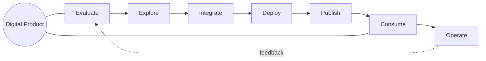

docType: ITVN

# IT4IT Value Network Template

> The single-integration view of the IT4IT Value Network (S261, Ch. 5): all seven
> value streams, their triggers, primary stakeholders, stage sequences, and
> cross-stream dependencies, with the Digital Product at the centre.

## Intake Interview Questions

The template-driven intake interview asks the questions below before rendering this
artefact. Every question below is always put to the user for their input, one
question at a time, and is prefilled where answerable from existing artefacts,
saved intake, onboarding data, or organisation config so the user can confirm or
override it. Each question is **optional**: a skipped question renders as a
`TBD` marker in the artefact. Source: The Open Group IT4IT Standard, Version 3.1
(Snapshot), S261 (reference only — not a conformance claim).

### Intake questions (IT4IT value network)

- **Scope:** Which IT product portfolio or programme is this Value Network for?
- **Digital Product:** What is the Digital Product (the anchor KDO bundle) at the centre of the network?
- **Stream coverage:** Are all seven value streams in scope, or is this a partial network view?
- **Scenarios:** Which scenarios from the S261 scenario catalog does this view cover?
- **Feedback loop:** How does the Operate stream feed findings back into Evaluate?

| Field | Value |
|---|---|
| **Issue** | `${user_config.project_issue_prefix}-000` — IT4IT Value Network |
| **Parent** | `${user_config.references_dir}` — parent engagement reference, if any |
| **Organisation** | `${user_config.organisation_name}` |
| **Date** | 2026-11-06 |
| **Status** | Draft |
| **Author** | Enterprise Architecture Lead |
| **Owner** | Digital Product Portfolio Manager |
| **Replaces** | — |

### IT4IT Standard (S261) interview questions

Grounded in the IT4IT v3.1 Value Streams chapter (S261 Ch. 5); each answer feeds
the stream map and dependency map below.

- **Seven streams (S261 Ch. 5):** Confirm the trigger, primary stakeholder, and stage sequence for each of the seven streams — Evaluate, Explore, Integrate, Deploy, Publish, Consume, Operate.
- **Cross-stream dependencies (S261 Ch. 5):** Which handoff KDOs cross stream boundaries, and what is the contract (cardinality + system-of-record obligation) at each handoff?
- **Digital Product backbone (S261 Ch. 11):** How are the Digital Product Backbone (Digital Product, Digital Product Contract, Service Offering, System) and the Service Offering Backbone (Service Offering, Order, Subscription) positioned per stream?
- **Scenarios (S261 Ch. 5):** Which scenarios does this network view cover, and which are out of scope?

## Stream Map

| # | Value Stream | Trigger | Primary Stakeholder | Stage Sequence |
|---|---|---|---|---|
| 1 | **Evaluate** | Portfolio planning cycle | Product Portfolio Manager | Gather Influencers → Identify Gaps → Propose Investments → Define Backlog Mandates → Ensure Governance |
| 2 | **Explore** | Changed Resource Plan | Product Manager | Prioritize Backlog Items → Define Digital Product Architecture → Refine Product Backlog → Finalize Roadmap & Resource Plan |
| 3 | **Integrate** | Work pulled from Product Backlog | Product Manager + Dev Teams | Plan Product Release → Design & Develop → Build, Integrate, & Test → Accept & Publish Release |
| 4 | **Deploy** | Approved Product Release | Product Manager | Plan & Approve Deployment → Fulfill Deployment → Validate Deployment → Observe Deployment |
| 5 | **Publish** | Product Release / Portfolio decision | Catalog Manager | Define Service Offering → Implement Service Offering → Publish Service Offering |
| 6 | **Consume** | Consumer selects an offering | Consumer | Select an Offering → Agree to Service Offering → Subscribe → Provide Service Support → Publish Service Status |
| 7 | **Operate** | Detected issue / scheduled maintenance | Consumer | Detect Issue → Diagnose Issue → Resolve Issue |

> Confirm, override, or extend each row above. Where a stream is not in scope,
> mark it and note the reason.

## Cross-Stream Dependency Map

| Source Stream | Target Stream | Handoff KDO | Contract (cardinality + system-of-record) |
|---|---|---|---|
| All streams | Evaluate | Ideas / improvements / demand | |
| Evaluate | Explore | Qualified Portfolio Backlog Item | |
| Explore | Integrate | Product Backlog Item | |
| Integrate | Deploy | Approved Product Release | |
| Deploy | Publish | Deployed release | |
| Publish | Consume | Service Offering (catalog) | |
| Consume | Operate | Service Contract | |
| Operate | Evaluate | Operational findings | |

> Record the system of record for each handoff KDO. Deviations from the S261
> cardinalities are recorded as gaps, not choices.

## Digital Product Positioning

| Backbone | KDOs | Positioned Per Stream |
|---|---|---|
| **Digital Product Backbone** | Digital Product, Digital Product Contract, Service Offering, System | |
| **Service Offering Backbone** | Service Offering, Order, Subscription | |

## Scenarios in Scope

- [ ] Scenario 1: [name from S261 catalog]
- [ ] Scenario 2: [name from S261 catalog]

## Conformance Notes

This artefact **references** the IT4IT Standard v3.1 (S261, snapshot) as a
reference architecture. S261 is a snapshot, not an approved standard; no
conformance claim is made. Vendor refinements are non-normative extensions.

## Mermaid

