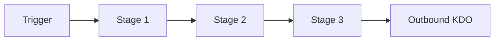

# IT4IT Value Stream Template

> One value stream of the IT4IT Value Network (S261, Ch. 5): scenario,
> trigger, primary stakeholder, stage sequence, participating functional
> components, and key data objects flowing through the stages.

## Intake Interview Questions

The template-driven intake interview asks the questions below before rendering this
artefact. Every question below is always put to the user for their input, one
question at a time, and is prefilled where answerable from existing artefacts,
saved intake, onboarding data, or organisation config so the user can confirm or
override it. Each question is **optional**: a skipped question renders as a
`TBD` marker in the artefact. Source: The Open Group IT4IT Standard, Version 3.1
(Snapshot), S261 (reference only — not a conformance claim).

### Intake questions (IT4IT value stream)

- **Which value stream:** Evaluate, Explore, Integrate, Deploy, Publish, Consume, or Operate?
- **Scenario:** Which of the stream's scenarios does this artefact cover (e.g. "Deploy a New Product Release Version")?
- **Trigger:** What triggers the stream — portfolio planning cycle, changed resource plan, backlog pull, approved release, consumer selection, or detected issue?
- **Primary stakeholder:** Who owns the stream — Digital Product Portfolio Manager, Digital Product Manager, Catalog Manager, or Consumer?
- **Cross-stream inputs/outputs:** Which upstream stream feeds this one, and what does this one hand downstream?

| Field | Value |
|---|---|
| **Issue** | `${user_config.project_issue_prefix}-000` — IT4IT Value Stream: [Stream Name] |
| **Parent** | `${user_config.references_dir}` — parent engagement reference, if any |
| **Organisation** | `${user_config.organisation_name}` |
| **Date** | 2026-11-06 |
| **Status** | Draft |
| **Author** | Enterprise Architecture Lead |
| **Owner** | Digital Product Manager / Portfolio Manager (per stream) |
| **Replaces** | — |

### IT4IT Standard (S261) interview questions

Grounded in the IT4IT v3.1 Value Streams chapter (S261 Ch. 5); each answer feeds
the stream definition below.

- **Stage sequence (S261 Ch. 5):** Which of the stream's stage sequence applies, and where does customisation or extension occur?
- **Participating functional components (S261 Ch. 6–10):** Which functional components support each stage (e.g. Portfolio Backlog, Proposal for Evaluate; Product Backlog, Pipeline for Integrate)?
- **Key data objects (S261 Ch. 11):** Which KDOs flow through the stages — which originate here, which are consumed from upstream, which are published downstream?
- **Systems of record:** Which system is the authoritative source for each KDO this stream controls?

## Stream Definition

### Trigger

| Field | Value |
|---|---|
| **Trigger condition** | |
| **Trigger frequency** | |
| **Trigger source (upstream stream)** | |

### Primary Stakeholder

| Field | Value |
|---|---|
| **Primary stakeholder** | |
| **Accountable role** | |
| **Contributing roles** | |

### Stage Sequence

| # | Stage | Participating Functional Components | KDOs in | KDOs out |
|---|---|---|---|---|
| 1 | | | | |
| 2 | | | | |
| 3 | | | | |

### Cross-Stream Dependencies

| Direction | Stream | Handoff KDO | Contract |
|---|---|---|---|
| Inbound | | | |
| Outbound | | | |

### Scenarios Covered

- [ ] Scenario 1: [name]
- [ ] Scenario 2: [name]

### Conformance Notes

This artefact **references** the IT4IT Standard v3.1 (S261, snapshot) as a
reference architecture. S261 is a snapshot, not an approved standard; no
conformance claim is made. Vendor refinements are non-normative extensions.

## Mermaid

