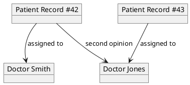
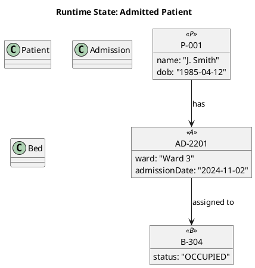

# PlantUML Object Diagram Reference

Object diagrams show the runtime state of a system — concrete instances of classes, their attribute values at a point in time, and the links between live objects. They complement class diagrams (the static blueprint) and sequence diagrams (the time axis) by answering "what does the system look like right now, for this scenario?".

Object diagrams are the only UML view with no Mermaid equivalent — Mermaid has no object-diagram grammar. This is the rationale for PlantUML-only notation in the `/arckit:solution-design` command.

---

## Basic Syntax



## Object Declaration

### Plain Objects

```plantuml
object "Instance Label"
object InstanceLabel
```

### Objects with Attribute Values

```plantuml
object "Order #1024" as o {
    total: 59.99
    status: "PAID"
}

object "Customer 42" as c {
    name: "Jane Doe"
    email: "jane@example.com"
}

c --> o: "placed"
```

### Objects of a Named Class

The `«class»` stereotype links the instance to the static model:

```plantuml
class "Patient" as P
object "P001" as p1 <<P>>
object "P002" as p2 <<P>>

p1 .-- P: "instance of"
p2 .-- P: "instance of"
```

### Objects with Initialisation

```plantuml
object "Session S1" as s1 <<Session>>
s1 @14:00 {
    user: "admin"
    action: "login"
}
```

## Link Types

| Syntax | Meaning |
|--------|---------|
| `obj1 --> obj2` | Directed link (reference) |
| `obj1 -- obj2` | Undirected link |
| `obj1 ..> obj2` | Dashed reference (weak/external) |
| `obj1 -[#red] obj2` | Coloured link |

### Link Labels

```plantuml
p1 --> doc1: "assigned to"
p1 --> doc2: "second opinion" [hidden]
```

## Grouping

```plantuml
rectangle "Ward A" {
    object "Bed A1" as a1
    object "Bed A2" as a2
}

rectangle "Ward B" {
    object "Bed B1" as b1
}
```

## Colours and Styling

```plantuml
object "Active Record" as r #LightGreen
object "Archived Record" as r2 #LightGray

skinparam object {
    BackgroundColor #FFFFFF
    BorderColor #333333
    FontColor #333333
}
```

## Complete Example



## Gotchas

- **Instance values must be quoted if they contain special characters** — `total: 59.99` renders as a string automatically, but `note: "has ' and "` needs the inner quotes escaped or the attribute line will break the parser.
- **Object IDs are case-sensitive** — `object "Bed A1"` and `object "bed a1"` are distinct objects even if they refer to the same class.
- **Don't mix class and object declarations without the stereotype link** — `object "P001" <<Patient>>` without a matching `class "Patient"` renders fine but the instance-of link is lost in the model.
- **Attribute values are static per diagram** — an object diagram is a snapshot. For time-varying state use a sequence diagram instead.

## References

- [PlantUML Object Diagram Documentation](https://plantuml.com/object-diagram)
- [UML 2.5.1 Object Diagrams (OMG specification)](https://www.omg.org/spec/UML/)
