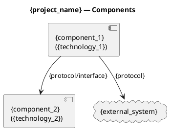
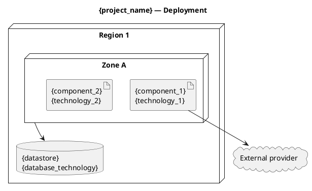
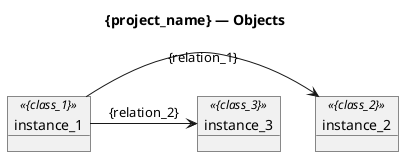

# Solution Design: {project_name}

> **Template Origin**: Official | **ArcKit Version**: [VERSION] | **Command**: `/arckit:solution-design`

## Document Control

<!-- DOC-CONTROL-HEADER -->
<!-- Resolved at command-execution time to _partials/document-control-uk.md or _partials/document-control-uae.md based on plugin userConfig classification_scheme + governance_framework. See _partials/RENDERING.md (when present). -->

## Revision History

| Version | Date | Author | Changes | Approved By | Approval Date |
|---------|------|--------|---------|-------------|---------------|
| [VERSION] | [DATE] | ArcKit AI | Initial creation from `/arckit:solution-design` command | PENDING | PENDING |

---

## Use Case Diagram

Shows the system's actors and the use cases they interact with in this solution design context.

```plantuml
@startuml
title {project_name} — Use Cases

left to right direction
actor {actor_1} as A1
actor {actor_2} as A2

rectangle {system_name} {
  usecase "Use case 1" as UC1
  usecase "Use case 2" as UC2
}

A1 --> UC1
A2 --> UC2
A1 ..> UC2 : <<include>>

@enduml
```

**View this diagram**:

- **Online**: https://www.plantuml.com/plantuml/uml/ (paste code above)
- **VS Code**: Install PlantUML extension (jebbs.plantuml)
- **CLI**: `java -jar plantuml.jar diagram.puml`
- **Export**: Use PlantUML Server to export as PNG/SVG/PDF

---

## Sequence Diagram

Shows the key interaction flows between actors and components in this solution.

```plantuml
@startuml
title {project_name} — Sequence

actor {actor_1} as A1
participant "{component_1}" as C1
participant "{component_2}" as C2
database "{datastore}" as DB

A1 -> C1 : {request_1}
C1 -> C2 : {request_2}
C2 -> DB : {operation}
C2 --> C1 : {response_2}
C1 --> A1 : {response_1}

@enduml
```

**View this diagram**:

- **Online**: https://www.plantuml.com/plantuml/uml/ (paste code above)
- **VS Code**: Install PlantUML extension (jebbs.plantuml)
- **CLI**: `java -jar plantuml.jar diagram.puml`
- **Export**: Use PlantUML Server to export as PNG/SVG/PDF

---

## Component Diagram

Shows the component boundaries and dependencies that make up this solution.



**View this diagram**:

- **Online**: https://www.plantuml.com/plantuml/uml/ (paste code above)
- **VS Code**: Install PlantUML extension (jebbs.plantuml)
- **CLI**: `java -jar plantuml.jar diagram.puml`
- **Export**: Use PlantUML Server to export as PNG/SVG/PDF

---

## Deployment Diagram

Shows the infrastructure topology on which this solution is deployed.



**View this diagram**:

- **Online**: https://www.plantuml.com/plantuml/uml/ (paste code above)
- **VS Code**: Install PlantUML extension (jebbs.plantuml)
- **CLI**: `java -jar plantuml.jar diagram.puml`
- **Export**: Use PlantUML Server to export as PNG/SVG/PDF

---

## Class Diagram

Shows the key domain model classes and their relationships for this solution.

```plantuml
@startuml
title {project_name} — Class

class {class_1} {
  +{field_1}: {type}
  +{field_2}: {type}
  +{method_1}({params})
}
class {class_2} {
  +{field_1}: {type}
}

{class_1} "1" -- "*" {class_2} : {association}

@enduml
```

**View this diagram**:

- **Online**: https://www.plantuml.com/plantuml/uml/ (paste code above)
- **VS Code**: Install PlantUML extension (jebbs.plantuml)
- **CLI**: `java -jar plantuml.jar diagram.puml`
- **Export**: Use PlantUML Server to export as PNG/SVG/PDF

---

## Object Diagram

Shows runtime object instances and their current state for this solution.



**View this diagram**:

- **Online**: https://www.plantuml.com/plantuml/uml/ (paste code above)
- **VS Code**: Install PlantUML extension (jebbs.plantuml)
- **CLI**: `java -jar plantuml.jar diagram.puml`
- **Export**: Use PlantUML Server to export as PNG/SVG/PDF

---

## Summary

- **Solution scope**: [2-3 sentences describing the purpose of this solution design and the problem it addresses]
- **Key design decisions**: [Summary of the most important architectural choices and their rationale]
- **Component count**: [X] components identified across the diagrams
- **Integration points**: [X] external integrations mapped
- **Deployment targets**: [X] environments/zones identified
- **Open questions**: [Any unresolved design items flagged during this run]

---

## External References

> This section provides traceability from generated content back to source documents.
> Follow citation instructions in the project's citation reference guide.

### Document Register

| Doc ID | Filename | Type | Source Location | Description |
|--------|----------|------|-----------------|-------------|
| *None provided* | — | — | — | — |

### Citations

| Citation ID | Doc ID | Page/Section | Category | Quoted Passage |
|-------------|--------|--------------|----------|----------------|
| — | — | — | — | — |

### Unreferenced Documents

| Filename | Source Location | Reason |
|----------|-----------------|--------|
| — | — | — |

---

**Generated by**: ArcKit `/arckit:solution-design` command
**Generated on**: [DATE]
**ArcKit Version**: [VERSION]
**Project**: [PROJECT_NAME]
**Model**: [AI_MODEL]
